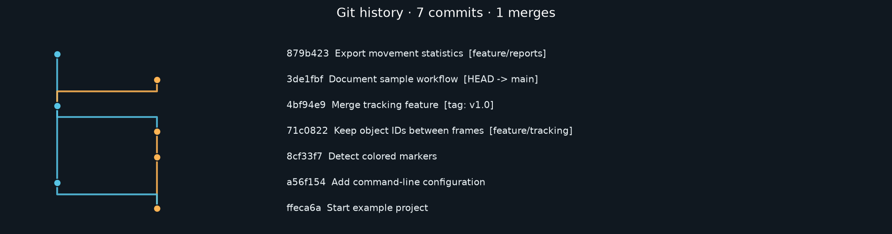

# Git commit graph

Git history can be hard to follow when work splits into branches and later merges together. This program draws those connections so you can see how the commits fit together. It shows commit messages, short hashes, branch names, and tags.



## Reading the graph

Each dot is a commit, and the lines connect it to its parent commits. Parents are the earlier commits that it builds on. A merge can have more than one parent because it joins work from different branches.

The program uses a topological order. That means every displayed commit appears above its displayed parents. It checks the order with Kahn's algorithm, which starts with commits that have no displayed children and works backward through their parents.

Separate paths get drawing lanes. The first parent normally stays in the same lane, while extra parents can use another free lane. The colors belong to those lanes. They do not always match permanent branch names because one commit can belong to several branches.

Solid lines connect commits that are in the picture. A dashed arrow means a parent is outside the chosen view. This can happen when the commit limit cuts off the older part of the history. Branch and tag labels come from Git. Long messages and labels are shortened in the picture, but the JSON export keeps the full text.

## Choosing what to show

By default, the program follows HEAD, which is the commit currently checked out. Use `--all` to include all locally available refs. A ref is a name that points to a commit, such as a branch or tag. Use `--ref` to follow just one branch, tag, or commit. These two options cannot be used together.

The program only reads the local repository. It does not fetch remote updates, switch branches, or write commits. A shallow clone only contains part of the history, so the program can only show what Git has locally.

The commit limit can be between 1 and 2,000. Big graphs get tall. A smaller limit or an SVG file is usually easier to read.

## Saved results

The graph can be saved as PNG, SVG, or PDF. Use `--no-show` when you want to save the picture without opening a window. `--no-subjects` hides commit messages in the picture. They are still included in the JSON file.

The program prints counts for commits, merges, roots, tips, and branch points. A root has no parent commits. A tip has no children in the selected history. A branch point has more than one child. These counts describe the selected history, which may be only part of the repository.

The JSON file also stores each commit's hash, parents, author, date, message, refs, lane, row, and any parents outside the view. Author details and commit messages come from the repository, so check the file before sharing it.

## The pictured example

The picture above uses a temporary sample repository with two feature branches, one merge, and a tag. It is not this project's actual development history. `demo.py` builds that sample, saves the images and JSON, and removes the temporary repository afterward.

## Try it

Use Python 3.11 or newer. Open a terminal in this project's folder and create a virtual environment. This keeps its packages separate from your other Python projects.

```sh
python -m venv .venv
```

On Windows, activate it with this command.

```sh
.venv\Scripts\activate
```

On macOS or Linux, use this command instead.

```sh
source .venv/bin/activate
```

Then install the packages the project needs.

```sh
python -m pip install -r requirements.txt
```

```sh
python commit_graph.py . --output history.png --json history.json --no-show
python demo.py --output demo-output
```

Git must also be installed and available on PATH. The first command draws this repository's history. The second makes the separate sample shown above.

```sh
python commit_graph.py ../another-repository --all --limit 80 --output graph.svg --no-show
python commit_graph.py ../another-repository --ref main --output main.png --json main.json --no-show
python commit_graph.py ../another-repository --ref v1.0 --limit 40
python commit_graph.py . --no-subjects --output compact.pdf --no-show
```

`history.py` reads Git data, checks the order, and calculates counts. `commit_graph.py` places the commits and draws the graph. `demo.py` makes the temporary sample repository.

## Tests

```sh
python -m pip install -r requirements-dev.txt
python -m pytest -q
```

The tests create temporary Git repositories and check merges, labels, ref selection, commit limits, metadata, and image export. They also check unordered input, disconnected histories, and invalid cycles. GitHub Actions runs the same tests.
